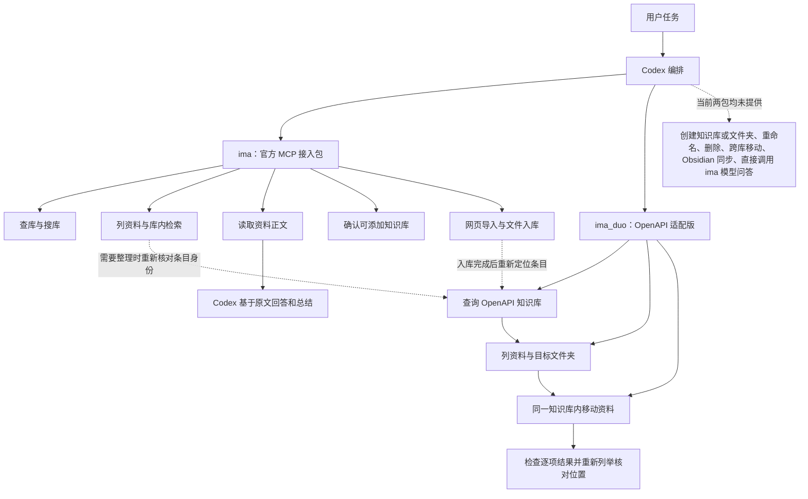

# ima 官方 MCP 与 ima-duo：关系、协作和能力图谱

本文描述 My-skills 中已接入的两个服务，截至 2026-11-02 的能力快照。官方 MCP 本次重新握手并发现 9 个工具；ima-duo 适配版由本地代码提供 3 个工具。共 12 个工具入口，包含查询能力重叠，不能理解为 12 种互不重复的业务能力。后续官方能力以连接时的 `tools/list` 为准。

## 两者是什么关系

| 项目 | 官方 MCP 接入包 `ima-mcp` | Codex 适配版 `ima-duo-mcp` |
| --- | --- | --- |
| Codex MCP 服务名 | `ima` | `ima_duo` |
| 上游来源 | ima 官方远程 MCP；本仓库提供本地接入适配器 | 根据 [zeriehan/ima-duo](https://github.com/zeriehan/ima-duo) 的接口契约实现；[版本和改动](UPSTREAM.md) |
| 服务路径 | Codex → 本地 stdio 桥 → `https://ima.qq.com/mcp` | Codex → 本地 stdio 服务 → `https://ima.qq.com/openapi/wiki/v1/…` |
| 主要职责 | 发现知识库、检索、读取和资料入库 | 取得 OpenAPI 下的真实 ID，并在同库内移动资料 |
| 凭证 | ima MCP 专用令牌 | ima OpenAPI Client ID + API Key |
| 初始授权及更新 | 本机 WorkBuddy 登录并连接 ima 后，由脚本获取令牌 | 从 ima 官方配置页取得凭证，经本地表单或环境变量导入 |
| 日常是否需要 WorkBuddy | 有效缓存期间可关闭；默认在缺少有效缓存或 HTTP 401 时尝试取新授权，可配置禁止运行时访问 WorkBuddy | 不需要安装或运行 WorkBuddy，也不需要 Obsidian |
| 本地凭证位置 | `${CODEX_HOME}/ima-mcp/auth.dpapi.json`；未设置 CODEX_HOME 时使用 `~/.codex`，可用 `IMA_MCP_AUTH_FILE` 覆盖 | `${CODEX_HOME}/ima-duo-mcp/credentials.dpapi.json`；未设置 CODEX_HOME 时使用 `~/.codex` |
| 平台与保存方式 | 本包支持 Windows，DPAPI CurrentUser 加密 | 本包支持 Windows，DPAPI CurrentUser 加密 |

两者并列运行，均直接访问 ima 服务端；`ima_duo` 不调用 `ima`，`ima` 也不依赖 `ima_duo`。组合流程由 Codex 根据任务调用相应工具，尚未实现自动 ID 转换、统一权限层或跨服务事务。任一服务授权失败不代表另一个也失效；也不能用另一个服务的凭证替代。

原始 ima-duo 是 Obsidian 同步插件。本机适配版只取其中查库、列资料和同库移动的接口契约，没有安装原插件，也没有移植其完整同步能力。

## 完整能力图谱

图中的虚线表示需要额外核对的编排步骤或当前边界，不表示自动同步和自动 ID 转换。

| 业务能力 | `ima` 官方 MCP | `ima_duo` 本机适配版 | 组合后的使用方式与边界 |
| --- | --- | --- | --- |
| 列举知识库 | `get_knowledge_base_list` | `list_knowledge_bases` | 查询有重叠；分别取得各自接口的 ID，访问范围分别以回执为准 |
| 按关键词搜知识库 | `search_knowledge_base` | 无独立关键词搜索工具；查库请求固定空查询 | 优先用官方搜库；移动前仍须在 duo 侧定位目标库 |
| 列举库内资料 | `get_knowledge_list` | `list_knowledge` | 查询有重叠；duo 可按 `folder_id` 列举目标目录，两个服务都需要处理分页 |
| 库内关键词检索 | `search_knowledge` | 无 | 官方检索后按需读取；需要移动时重新在 duo 侧核对条目 |
| 读取资料正文 | `fetch_media_content` | 无 | 由官方读取可访问、可解析的内容；列出条目不等于正文可读 |
| 根据资料回答、归纳、比较 | Codex 结合检索和正文完成 | 不单独提供正文读取 | 这是 Codex 的编排能力，不是 ima 模型问答工具 |
| 确认可添加的知识库 | `get_addable_knowledge_base_list` | 无 | 官方写入前确认；可添加权限不证明有移动或管理权限 |
| 导入网页 | `import_urls` | 无 | 官方导入；如果还需归档，再在 duo 侧定位并移动 |
| 本地文件入库 | `create_media` + 按返回方式上传 + `add_knowledge` | 无 | 不是一个原子步骤；创建媒体、上传成功、添加成功和解析完成分别核对 |
| 同库内移动资料 | 当前无 | `move_knowledge` | duo 补充的主要能力；一次 1–50 个资料，目标须是已存在文件夹或根目录 |
| 移动文件夹、跨库移动 | 当前无 | 无 | 组合后仍不支持；不通过复制再删除模拟移动 |
| 创建知识库、创建文件夹 | 当前无 | 无 | 需要先在 ima 客户端创建，或另行明确开发扩展 |
| 重命名、编辑已有资料正文 | 当前无对应工具 | 无 | 组合后仍不支持；文件入库不等于修改既有条目 |
| 删除、永久删除、回收站管理 | 当前无 | 无 | 移动到已有的普通“归档”目录可以；这不等于回收站或删除能力 |
| Obsidian 双向同步、定时自动同步 | 无 | 无 | 原项目的插件功能没有被移植；组合不会自动产生同步任务 |
| 直接调用 ima 模型进行知识库问答 | 当前无 | 无 | 可让 Codex 基于官方检索和正文回答，不能描述为调用了 ima 模型 |

以上“无”只表示当前这两个已安装服务没有暴露该能力，不表示 ima 产品本身或上游原项目永远没有相关接口。

## 工具分工与使用规则

读取、检索、问答和入库优先用 `ima`；用户明确要求整理资料位置时，用 `ima_duo`。仅仅问一个知识问题，不需要先调用两套查库工具。仅要求移动且条目身份已确定时，也可以全程使用 duo，官方 MCP 不是移动的前置依赖。

官方 9 个工具为 `get_knowledge_base_list`、`search_knowledge_base`、`get_knowledge_list`、`search_knowledge`、`fetch_media_content`、`get_addable_knowledge_base_list`、`import_urls`、`create_media`、`add_knowledge`。duo 3 个工具为 `list_knowledge_bases`、`list_knowledge`、`move_knowledge`。这里的服务名前缀用于说明路由；实际调用名称以当前 Codex 注册和工具发现结果为准。

两者的查库和列资料看起来重复，是因为移动接口需要本接口返回的真实标识。不能仅因字段都叫 `knowledge_base_id` 或 `media_id`，就假定可以直接互传；也没有证据表明两边 ID 必然不同。做法是分别查询并核实，不猜测、不转码、不拼接。

跨服务操作前，确认两套凭证连接的是预期账号，并核实两边看到的是同一个知识库和同一资料。知识库名称和资料标题只是候选线索，应结合可获得的原始链接、资料类型、目录、时间等信息确认；同名、信息不足或找不到对应条目时，先补充查询，必要时询问用户，不挑一个近似结果移动。某一服务可见、可读或可添加，不证明另一个服务可见或有移动权限。共享、订阅库尤其需要分别确认；不尝试绕过权限。

分页未完成不称全量；新导入资料可能尚未解析或尚未出现在另一接口的查询结果中。此时说明未就绪并核实状态，不能直接推断入库失败、重复导入或强行移动。

## 配合使用的典型流程

### 查资料并回答

1. `ima` 查库或搜库，确定检索范围。
2. `ima.search_knowledge` 检索相关资料，按需用 `fetch_media_content` 读取正文。
3. Codex 根据实际正文回答，保留标题和可用来源链接；区分没有结果、无权限及内容未解析。

不调用 duo，不更改资料位置，也不声称调用了 ima 模型。

### 将已有资料归档到同库文件夹

1. 可选：用户只提供主题时，先用官方检索和正文定位、理解候选资料。
2. `ima_duo.list_knowledge_bases` 找到 OpenAPI 下对应的知识库。
3. `ima_duo.list_knowledge` 分页定位待移动资料及已存在的目标文件夹，核对身份和目录。跨服务找到的 ID 不直接复用。
4. 确定用户要求的资料和目标后，调用 `move_knowledge`；移到根目录显式传 `destination_folder_id: ""`。不支持移动文件夹或移到另一知识库。
5. 检查每个资料的 `outcomes`，再按需列举目标目录核对实际位置；部分失败分别报告。超时或响应不明时先核实位置，不直接重发移动请求。

### 导入网页或文件后再整理位置

1. `ima.get_addable_knowledge_base_list` 确认目标可添加，并确定用户要求的入库内容。
2. 网页使用 `import_urls`；文件依次完成 `create_media`、按回执上传、`add_knowledge`，核对每一步结果。
3. 如果入库工具的当前参数已支持所需目录，就按其契约直接指定；只有仍需移动时才增加 duo 步骤。
4. 用 duo 重新查询并确认新条目；需要正文读取时等待相应解析状态，不将“已接收”报告为“已解析”。
5. 确认目标目录已存在并执行同库移动，核对逐项结果和实际位置。

该组合不是事务：入库成功、移动失败时，资料仍可能已在库中，应报告实际状态，只处理未完成的整理步骤，不能重新导入整批。组合流程也不自动包含删除、建文件夹或定时同步。

## 授权与迁移时如何配合

两包需要分别安装和注册；只复制技能不意味着 MCP 已注册。Windows 配置步骤分别见 [官方 MCP 安装说明](../ima-mcp/README.md) 和 [duo 安装说明](README.md)。在另一电脑上分别配置授权，不复制本机 DPAPI 缓存，也不把凭证放入仓库。

官方接入包的 `doctor.mjs --standalone` 可检查禁止访问 WorkBuddy 时的握手与工具目录，加 `--read-test` 才做一次读取验证。duo 的 `auth.mjs status` 仅判断缓存存在，`auth.mjs check` 才发起只读查库验证。一个服务的诊断通过不等于另一个也可用，更不代表所有知识库都有写权限。

要严格禁止官方服务运行时访问 WorkBuddy，可为它设置 `IMA_MCP_WORKBUDDY=never`，此时取新授权需显式运行该包的 `auth.mjs login`。duo 的 API Key 与官方 MCP 令牌分别失效、分别更新，不假定共同有效期、相同配额或相同权限范围。

## 验证记录与依据

- 2026-11-02 重新通过 `doctor.mjs --standalone` 完成官方 MCP 握手和工具发现，禁止访问 WorkBuddy，返回 `kb-openapi-mcp/1.0.0` 的上述 9 个工具。
- 前序实测已验证官方知识库列表、资料检索和正文读取；网页和文件入库工具已发现，但没有为验证而写入用户资料。
- duo 查库和列资料已通过只读验证；用户明确反馈实际移动资料成功；已有 10 项客户端、MCP 调度及 Windows 凭证测试通过。
- “官方入库后由 duo 移动”的组合流程由当前工具能力编排而成，尚未执行完整写入链路验证；不能将分步验证描述为整条流程已经实测。
- 本文依据仓库接入代码、官方实时工具发现、既有只读验证及用户反馈。duo 的上游接口出处、版本与本地改动见 [UPSTREAM.md](UPSTREAM.md)；不扩展为对其他第三方项目或 ima 全产品能力的承诺。
